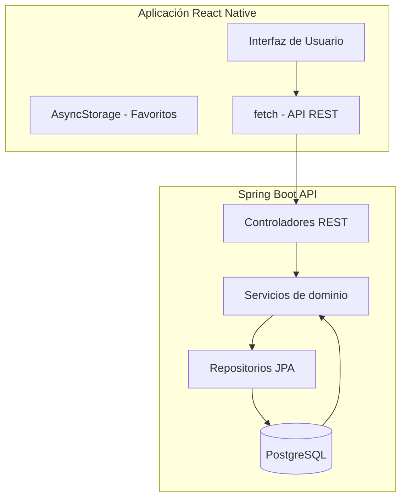

# automovilismo-app

Aplicación móvil Android dedicada al automovilismo argentino, permitiendo consultar información de categorías, pilotos, circuitos, eventos y resultados históricos.

## Descripción del problema

El automovilismo argentino, particularmente el Turismo Carretera, tiene una rica historia y una base de fanáticos apasionados. Sin embargo, no existe una aplicación móvil moderna y oficial que consolide la información histórica y actual de las categorías argentinas en un solo lugar accesible desde dispositivos móviles.

## Objetivos del MVP

- Permitir consultar el calendario de eventos de Turismo Carretera.
- Mostrar cronogramas de entrenamientos, clasificaciones, series y finales.
- Proporcionar información de circuitos argentinos.
- Listar y mostrar fichas de pilotos.
- Mostrar información de equipos y participaciones por temporada.
- Consultar resultados históricos y clasificaciones finales.
- Distinguir entre resultados provisionales y oficiales.
- Guardar pilotos favoritos localmente en el dispositivo.

## Funcionalidades incluidas (MVP)

- Calendario de eventos.
- Cronogramas de sesiones (entrenamiento, clasificación, series, final).
- Fichas de circuitos.
- Listado de pilotos con fichas individuales.
- Información de equipos y participaciones estacionales.
- Resultados históricos por temporada.
- Distinción provisional/oficial en resultados.
- Pilotos favoritos (localStorage/AsyncStorage).

## Funcionalidades excluidas (fuera del alcance inicial)

- Cronometraje en tiempo real.
- Cuentas de usuario y sincronización entre dispositivos.
- Notificaciones push.
- Mapas interactivos de circuitos.
- Noticias y reproducción de videos.

## Tecnologías previstas

### Aplicación móvil
- **React Native** con **Expo** (SDK 51+)
- **TypeScript** para tipado estático
- **Expo Router** para navegación basada en archivos
- **fetch** para peticiones HTTP al backend
- **AsyncStorage** (Expo) para persistencia de favoritos

### Backend
- **Python** 3.11+ con **FastAPI**
- **Pydantic** para validación de datos y esquemas
- **SQLAlchemy 2.x** para acceso a PostgreSQL
- **Alembic** para migraciones de base de datos
- **PostgreSQL** como base de datos
- **OpenAPI** generación automática desde los esquemas de Pydantic
- **Ruff** para análisis estático, linting y formato

### Infraestructura
- **Git y GitHub** para control de versiones
- **Docker** para facilitar ejecución reproducible de servicios
- **Docker Compose** para orquestar backend + PostgreSQL
- **GitHub Actions** para CI/CD y automatización de pruebas

## Diagrama de arquitectura



## Estructura del repositorio

```
automovilismo-app/
├── .gitignore
├── .editorconfig
├── AGENTS.md
├── MEMORY.md
├── README.md
├── docs/
│   ├── architecture.md
│   ├── roadmap.md
│   ├── data-sources.md
│   └── decisions/
├── data/
│   ├── samples/
│   └── schemas/
├── infra/
├── mobile/
│   ├── src/
│   ├── app.json
│   ├── app.config.js
│   ├── package.json
│   └── ...
├── backend/
│   ├── src/main/java/com/automovilismo/
│   │   └── ...
│   ├── src/main/resources/
│   │   ├── application.yml
│   │   └── db/
│   │       └── migration/
│   └── ...
└── ...
```

## Requisitos previos de instalación

- Node.js 20+ y npm/yarn
- **Python 3.11+**
- **uv** (gestor de dependencias y proyectos, recomendado)
- PostgreSQL 15+
- **Docker y Docker Compose** (recomendado para desarrollo)
- Android Studio (para desarrollo móvil)
- Expo CLI (`npm install -g expo-cli`)
- Git

## Configuración y ejecución

### Backend

```bash
# 1. Iniciar PostgreSQL y el backend con Docker Compose
docker compose up -d db api

# 2. Aplicar migraciones Alembic
cd backend
./backend/alembic upgrade head

# 3. Ejecutar la aplicación
cd backend
python -m uvicorn app.main:app --reload --host 0.0.0.0 --port 8080
```

La API estará disponible en `http://localhost:8080`

### Mobile

```bash
# 1. Instalar dependencias
cd mobile
npm install

# 2. Iniciar la aplicación
npx expo start
```

Escaneá el código QR con el aplicativo Expo Go en tu dispositivo Android, o usa el emulador de Android Studio.

### Estado actual

- [ ] Estructura de proyecto inicial creada
- [ ] Backend Spring Boot sin implementar
- [ ] Aplicación móvil React Native sin implementar
- [ ] Base de datos PostgreSQL sin configurar
- [ ] Carga de datos históricos pendiente

## Estrategia de pruebas

### Backend
- JUnit 5 tests para servicios y controladores
- Mockito para mocking de repositorios
- Testcontainers para pruebas de integración con base de datos real
- Cobertura mínima del 80% para lógica de negocio

### Mobile
- Tests unitarios con Jest
- Tests de integración con React Native Testing Library
- Testing de componentes de interfaz y navegación

## Gestión de datos históricos y fuentes

Los datos se incorporarán manualmente mediante archivos estructurados (CSV/JSON). Se priorizarán fuentes oficiales:

- **Turismo Carretera**: Datos oficiales del TPTC (Turismo Carretera Oficial)
- **Fechas y resultados**: Verificación de múltiples fuentes antes de considerar datos como definitivos
- **Datos ficticios**: Identificados claramente con etiqueta `ficticio` en archivos JSON

Ningún dato se obtendrá mediante scraping sin verificar las condiciones de reutilización. Los archivos de datos de muestra estarán en `data/samples/` con sus esquemas correspondientes en `data/schemas/`.

## Convenciones de Git

- **Ramificación**: Flujo standard GitFlow
  - `main`: Producciones estable, siempre desplegable
  - `dev`: Línea de desarrollo actual
  - `feature/*`: Nuevas funcionalidades (derivadas de `dev`)
  - `release/*`: Preparación de releases
  - `hotfix/*`: Correcciones urgentes (sobre `main`)

- **Mensajes de commit**: Formato Conventional Commits
  - `feat: ...` para nuevas funcionalidades
  - `fix: ...` para correcciones de bugs
  - `docs: ...` para cambios en documentación
  - `style: ...` para formateo, puntos comas, etc (no afecta comportamiento)
  - `refactor: ...` para refactoring que no es bug fix ni feature
  - `test: ...` para agregar tests faltantes
  - `chore: ...` para tareas de mantenimiento

- **Etiquetas**: `v1.0.0`, `v1.1.0`, `v2.0.0` para releases

## Roadmap de desarrollo

### Fase 1: Estructura inicial (actual)
- [x] Crear estructura de repositorio y documentación base
- [ ] Inicializar proyectos mobile y backend con Python + FastAPI
- [ ] Configurar PostgreSQL y Alembic
- [ ] Primera migración Alembic (base)
- [ ] Definir modelos de dominio y DTOs (con SQLAlchemy/Pydantic)

### Fase 2: API básica y datos estáticos
- [ ] Implementar endpoints de categorías y temporadas
- [ ] Cargar datos históricos de Turismo Carretera desde archivos JSON
- [ ] Implementar pantalla de calendario en mobile
- [ ] Pantalla de listado de pilotos

### Fase 3: Funcionalidades detalladas
- [ ] Cronogramas por evento (sesiones completas)
- [ ] Fichas de pilotos y equipos
- [ ] Resultados y clasificaciones finales
- [ ] Sistema de favoritos local

### Fase 4: Refactor y escalabilidad
- [ ] Arquitectura modular por dominios
- [ ] Fácil incorporación de nuevas categorías
- [ ] Optimización de queries y rendimiento

## Limitaciones conocidas

- Los datos iniciales serán estáticos (archivos JSON) hasta que se desarrolle el backend completo
- Sin integración con APIs externas de terceros sin verificación de condiciones
- Sin autenticación de usuarios en el MVP
- Sin persistencia en la nube para favoritos (solo local dispositivo)
- La navegación está pensada para ser lineal; aún no se han implementado pantallas profundas

## Licencias y atribución de datos

- Datos de Turismo Carretera: Se usarán datos verificables de fuentes oficiales cuando estén disponibles. Los datos de muestra identificados como `ficticios` no tienen restricciones de uso.
- Documentación y código: MIT License (o definir al momento del proyecto)
- Cualquier dato de terceros usado en `data/samples/` tendrá atribución correspondiente en su archivo respectivo.

---

**Última actualización**: 16 de octubre de 2026