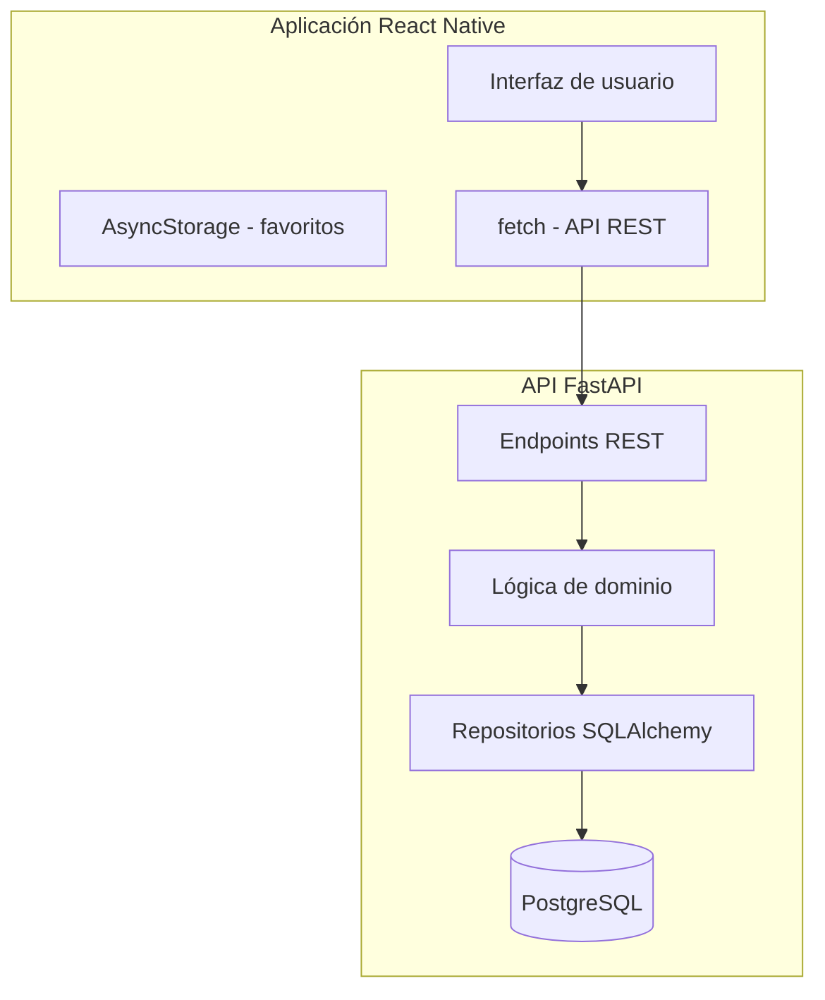

# automovilismo-app

Aplicación móvil Android para consultar información del automovilismo argentino, con foco inicial en Turismo Carretera (TC). El proyecto prevé una aplicación React Native con Expo y TypeScript, y una API Python con FastAPI.

## Objetivo del MVP

- Consultar el calendario y los cronogramas de los eventos.
- Ver circuitos, pilotos, equipos y participaciones por temporada.
- Consultar resultados históricos y distinguir los provisionales de los oficiales.
- Guardar pilotos favoritos localmente en el dispositivo.

Quedan fuera del alcance inicial el cronometraje en tiempo real, las cuentas de usuario, la sincronización entre dispositivos, las notificaciones push, los mapas interactivos, las noticias y los videos.

## Stack previsto

### Aplicación móvil

- React Native, Expo y TypeScript.
- Expo Router para navegación.
- `fetch` para consumir la API REST.
- AsyncStorage para favoritos locales.
- Jest y React Native Testing Library para pruebas.

La versión de Expo todavía no está fijada.

### Backend y datos

- Python 3.11 o superior y FastAPI.
- Pydantic para validación y esquemas.
- SQLAlchemy 2.x y Alembic para PostgreSQL.
- pytest para pruebas y Ruff para linting/formato.
- PostgreSQL como base de datos.

La API generará documentación OpenAPI desde FastAPI/Pydantic. El móvil no accederá directamente a la base de datos.

### Infraestructura prevista

Docker Compose para el entorno local es una propuesta del plan; todavía no hay configuración de Compose ni pipeline de CI en el repositorio.

## Arquitectura prevista

Este diagrama representa el diseño previsto, no componentes implementados.

## Estado del repositorio

Actualmente el repositorio contiene documentación y estructura inicial. `backend/`, `mobile/`, `data/` e `infra/` todavía no tienen una implementación funcional; no hay API, aplicación móvil, base de datos, migraciones, muestras de datos, pruebas ni configuración de Docker Compose.

Por ese motivo, aún no hay comandos de instalación, ejecución o pruebas del proyecto que puedan considerarse verificados. Los comandos previstos se documentarán cuando se inicialicen los componentes correspondientes.

## Datos y procedencia

Los datos deportivos deben ser verificables y tener su fuente documentada. No se debe inventar información ni automatizar su extracción sin comprobar antes las condiciones de reutilización. El plan prevé cargar datos manualmente desde archivos JSON; cualquier dato ficticio debe estar claramente identificado y no confundirse con datos reales.

## Documentación del proyecto

- [Constitución](docs/constitution.md): principios y restricciones.
- [Plan técnico del MVP](docs/specs/mvp/plan.md): alcance técnico, fases y decisiones.
- [Organización de especificaciones](docs/specs/mvp/README.md): flujo para crear y revisar specs.
- `MEMORY.md`: estado de continuidad del proyecto.

La estructura actual se puede consultar en [directory-tree.txt](directory-tree.txt). El plan técnico del MVP es la fuente de referencia para las fases; no hay un `docs/roadmap.md` separado.

## Licencias

La licencia del código y la documentación todavía no está definida. Los datos de terceros que se incorporen deberán incluir atribución y respetar sus condiciones de uso.

---

**Última actualización:** 20 de octubre de 2026.
