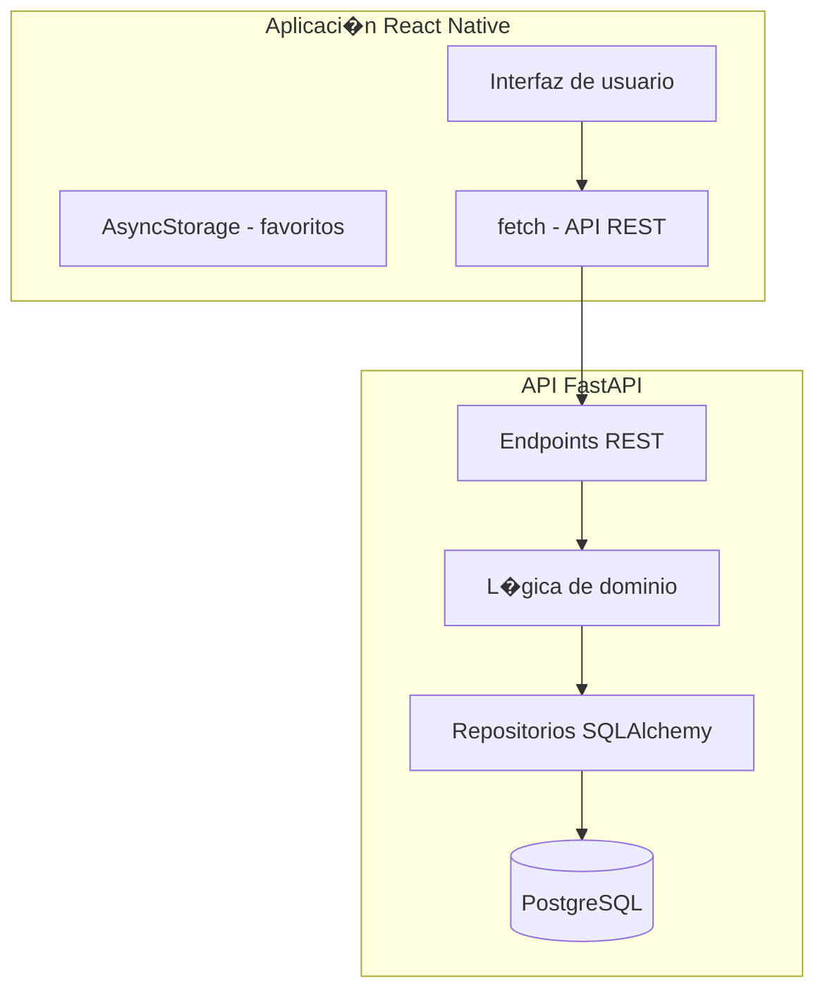

# automovilismo-app

Aplicaci�n m�vil Android para consultar informaci�n del automovilismo argentino, con foco inicial en Turismo Carretera (TC). El proyecto prev� una aplicaci�n React Native con Expo y TypeScript, y una API Python con FastAPI.

## Objetivo del MVP

- Consultar el calendario y los cronogramas de los eventos.
- Ver circuitos, pilotos, equipos y participaciones por temporada.
- Consultar resultados hist�sticos y distinguir los provisionales de los oficiales.
- Guardar pilotos favoritos localmente en el dispositivo.

Quedan fuera del alcance inicial el cronometraje en tiempo real, las cuentas de usuario, la sincronizaci�n entre dispositivos, las notificaciones push, los mapas interactivos, las noticias y los videos.

## Stack previsto

### Aplicaci�n m�vil

- React Native, Expo y TypeScript.
- Expo Router para navegaci�n.
- `fetch` para consumir la API REST.
- AsyncStorage para favoritos locales.
- Jest y React Native Testing Library para pruebas.

La versi�n de Expo todav�a no est� fijada.

### Backend y datos

- Python 3.11 o superior y FastAPI.
- Pydantic para validaci�n y esquemas.
- SQLAlchemy 2.x y Alembic para PostgreSQL.
- pytest para pruebas y Ruff para linting/formato.
- PostgreSQL como base de datos.

La API genera dokumentaci�n OpenAPI desde FastAPI/Pydantic. El m�vil no acceder� directamente a la base de datos.

### Infraestructura

Docker Compose para levantar el entorno local (PostgreSQL + FastAPI). Levantado y probado:

- `docker compose up -d`: inicia PostgreSQL en puerto 5432 y FastAPI en puerto 8080
- `docker compose down`: detiene los contenedores
- `docker compose ps`: verifica estado de los servicios

Comandos verificados:

```bash
# Verificar versi�n Python
python3 --version

# Levantar entorno con Docker Compose
docker compose up -d

# Verificar estado de contenedores
docker compose ps

# Detener contenedores
docker compose down

# Ejecutar la aplicaci�n sin Docker (solo API)
cd backend
python -m uvicorn app.main:app --reload --host 0.0.0.0 --port 8080
```

## Arquitectura prevista



Este diagrama representa el dise�o previsto, no componentes implementados.

## Estado actual del repositorio

El repositorio ha sido adaptado de Java + Spring Boot a Python + FastAPI. Estructura de documentación y directorios completada, y el backend levantado con Docker Compose.

### Logros recientes

- Backend Python + FastAPI estructurado con arquitectura de 4 capas
- Docker Compose levantando PostgreSQL + API simultáneamente
- API health check funcional en `/api/v1/health` (Status 200)
- Endpoints versionados en `/api/v1/`
- Esquemas Pydantic v2 con validación de datos
- Entidades SQLAlchemy 2.x con mapeo de categorías, pilotos, circuitos, temporadas, resultados
- Datos de muestra identificados con metadatos `is_ficticio` y `source`

### Comandos útiles

```bash
# Ver estructura de directorios
find . -type f -not -path "*/.git/*" -not -path "*node_modules/*" | sort

# Ver estado Git
git status

# Ver directorio tree
dir /b "C:\Users\Aaron\Desktop\AAProject"
```

### Fases del MVP (según plan técnico)

1. **Fase 1: Estructura y configuraci�n**
   - Repositorio y dokumentaci�n base (AGENTS.md, MEMORY.md, constitution.md)
   - Inicializar proyectos mobile y backend (Python + FastAPI)
   - Configurar PostgreSQL y Alembic
   - Primera migraci�n Alembic (base)

2. **Fase 2: API b�sica y datos est�ticos**
   - Endpoints de categor�as y temporadas
   - Cargar datos hist�ricos de TC desde archivos JSON
   - Pantalla de calendario en mobile
   - Pantalla de listado de pilotos

3. **Fase 3: Funcionalidades detalladas**
   - Cronogramas por evento (sesiones completas)
   - Fichas de pilotos y equipos
   - Resultados y clasificaciones finales
   - Sistema de favoritos local

4. **Fase 4: Refactor y escalabilidad**
   - Arquitectura modular por dominios
   - F�cil incorporaci�n de nuevas categor�as
   - Optimizaci�n de queries y rendimiento

## Datos y procedencia

Los datos deportivos deben ser verificables y tener su fuente documentada. No se debe inventar informaci�n ni automatizar su extracci�n sin comprobar antes las condiciones de reutilizaci�n. El plan prev� cargar datos manualmente desde archivos JSON; cualquier dato ficticio debe estar claramente identificado y no confundirse con datos reales.

### Metadatos de muestra

Los archivos en `data/samples/` identifican datos ficticios con:

- `is_ficticio: false` - Datos oficiales (TPTC, ACTC)
- `is_ficticio: true` - Datos de muestra/prueba
- `source` - Proveniencia del dato

Ejemplo estructura JSON:

```json
{
  "id": 1,
  "name": "Turismo Carretera",
  "is_ficticio": false,
  "source": "Oficial TPTC 2024",
  "data_generated": "2024-01-15T00:00:00Z"
}
```

## Documentaci�n del proyecto

- [Constituci�n](docs/constitution.md): principios y restricciones.
- [Plan t�cnico del MVP](docs/specs/mvp/plan.md): alcance t�cnico, fases y decisiones.
- [Organizaci�n de especificaciones](docs/specs/mvp/README.md): flujo para crear y revisar specs.
- `MEMORY.md`: estado de continuidad del proyecto.

La estructura actual se puede consultar en [directory-tree.txt](directory-tree.txt). El plan t�cnico del MVP es la fuente de referencia para las fases; no hay un `docs/roadmap.md` separado.

## Licencias

La licencia del c�digo y la documentaci�n todav�a no est� definida. Los datos de terceros que se incorporen deber�n incluir atribuci�n y respetar sus condiciones de uso.

---

�ltima actualizaci�n: 24 de octubre de 2026.
Actualizaci�n para adaptar stack de Java + Spring Boot a Python + FastAPI. Backend levantado con Docker Compose. API funcional verificada. Estado: estructura completada, implementaci�n de funcionalidades pending.